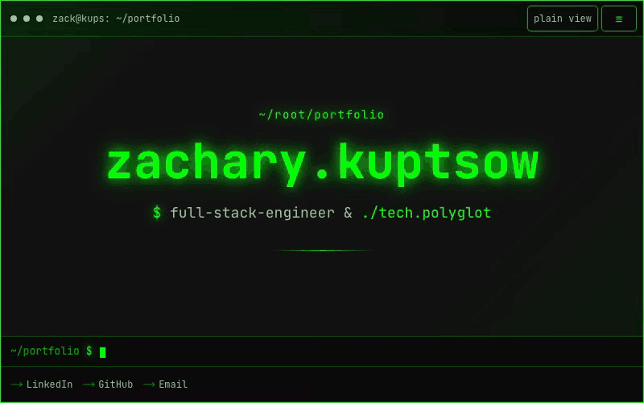

#  kups.me

**My portfolio, built as a terminal you scroll.** Live at [kups.me](https://kups.me).



Scroll, and a terminal types the next command and prints the next section: about, work, education,
skills, then a resume you can download or have emailed to you. Underneath it is plain HTML. With
reduced motion, no JavaScript or a printer, the same page reads as one column.

## What is in here

| Project | What it is | Built with |
| --- | --- | --- |
| [`projects/resume`](projects/resume) | The site, a static export | Next.js 15, React 19, Tailwind CSS 4 |
| [`projects/infrastructure`](projects/infrastructure) | Hosting for kups.me | AWS CDK: S3, CloudFront, Route 53, ACM |
| [`projects/send_resume`](projects/send_resume) | Emails my resume on request | Step Functions, Lambda, SES, DynamoDB |

Three independent projects in one repository. Each has its own dependencies, lockfile and README, and
nothing at the root ties them together.

## Worth a look

- **A terminal with nothing fake in it.** The engine moves, clips and hides real markup and writes no
  text of its own, so every word stays in the HTML for search engines and screen readers.
  [`projects/resume/components/Terminal/`](projects/resume/components/Terminal)
- **One swipe does one thing.** Trackpad momentum counts as part of the swipe that started it, so a
  flick runs one command and stops.
  [`engine/scrollGesture.ts`](projects/resume/components/Terminal/engine/scrollGesture.ts)
- **Checked in a real browser.** Playwright drives the installed Chrome to prove every line is readable
  whole at every scroll position, with a real scrollbar showing.
  [`projects/resume/test-browser/`](projects/resume/test-browser)
- **A deploy that cannot skip its gates.** Lint, types, tests, the build, checks of the built files and
  the browser checks all run first, and a red gate means nothing ships.
  [`.github/workflows/`](.github/workflows)
- **Resume by email, with limits.** Zod validation and a DynamoDB rate limit sit in front of a Step
  Functions workflow that sends through SES. [`projects/send_resume/`](projects/send_resume)
- **A supply chain scan before every install.** Each CI job that installs starts by scanning the commit,
  and every action is pinned to a commit SHA. [`.github/scripts/`](.github/scripts)

## Run it

```bash
corepack enable
cd projects/resume
yarn install
yarn dev
```

The build needs one environment variable, described under "Environment" in
[`projects/resume/README.md`](projects/resume/README.md).

## More

- [`docs/pipeline.md`](docs/pipeline.md): how the deploy and its checks work, and the rules for changing them.
- [`projects/resume/DESIGN.md`](projects/resume/DESIGN.md): the design brief.
